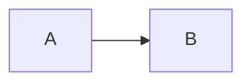

<!--
Write the PR in this order. Keep it short. Use ASD-STE100 Simplified Technical
English: short sentences, active voice, one meaning per word.
1. Why: 1-3 plain sentences. Intent first, before any detail.
2. A diagram (mermaid) where it helps.
3. What changes.
4. Acceptance criterion -> evidence table.
5. Risk tier, review lenses and their outcome.
6. What you did not do, with follow-up issues.
Delete these comments before you submit if you like. They do not render.
-->

## Why

<!-- 1-3 plain sentences. -->

Closes #

<!-- Optional diagram:

-->

## What changes

-

## Acceptance criteria -> evidence

<!-- One row per criterion from the issue. Evidence is a test name, a scenario, or command output. -->

| Acceptance criterion | Evidence |
|---|---|
| | |

## Risk tier

<!-- critical | normal | low. See .agents/pipeline.yaml and .agents/reviews/README.md. -->

## Review lenses

<!-- Lenses you ran (.agents/reviews/), and how you resolved each finding. -->

| Lens | Outcome |
|---|---|
| | |

## Not done

<!-- What you left out, with a follow-up issue for each item. Write "Nothing" if complete. -->

-
