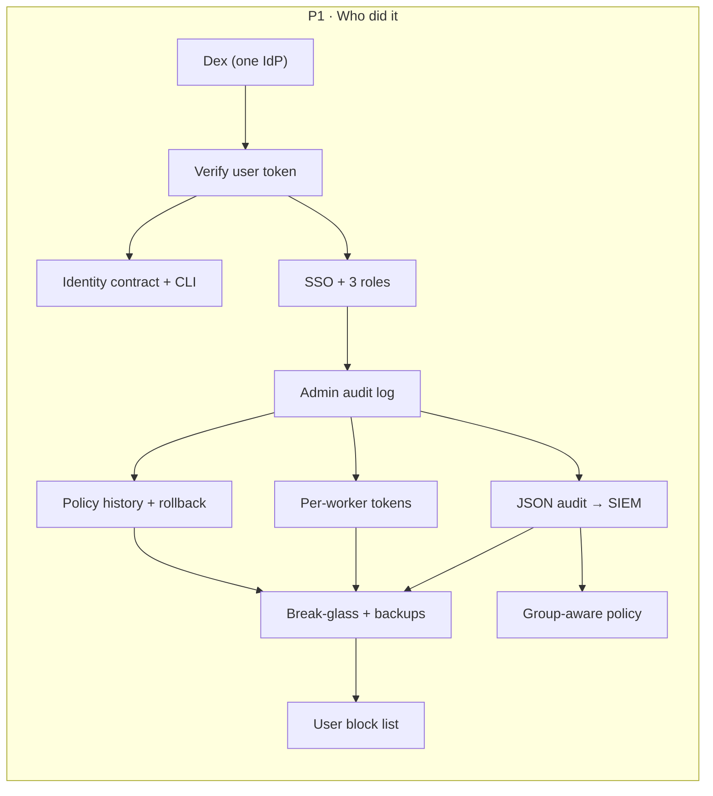
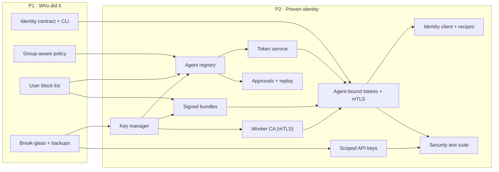
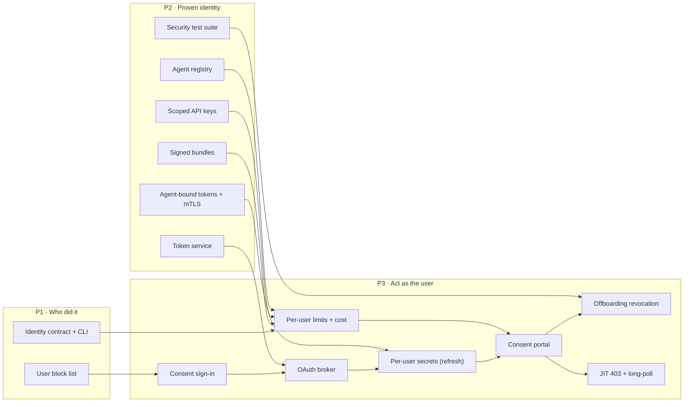
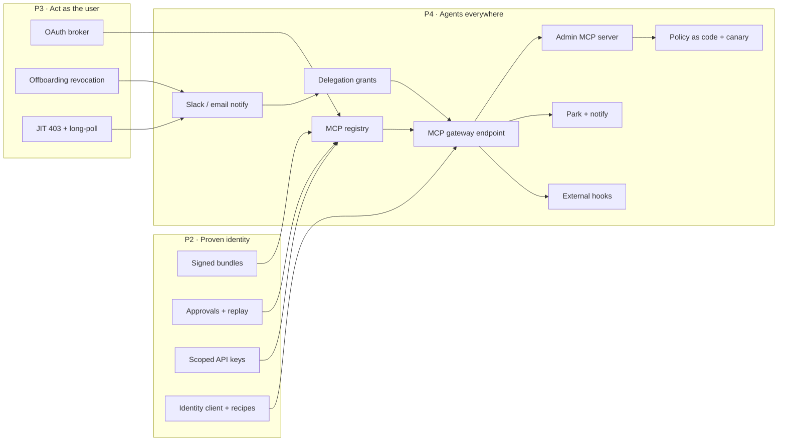
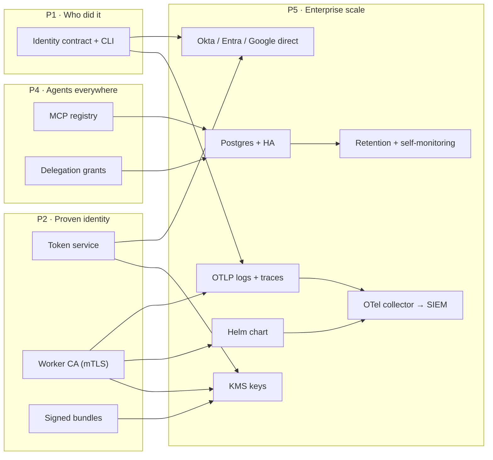

# Warden roadmap

<!-- Generated by `go run docs/roadmap/gen.go docs` from tickets.json. Do not edit by hand. -->

Every agent request already goes through Warden. This roadmap adds **who** each request is for, lets an agent **act as that user** with consent, and gives the company a **control plane** it can run. There are five phases, and each one ships on its own.

| Start here | What it is |
|---|---|
| [`plan.html`](plan.html) | The whole plan on one page: final design, phases, every feature and ticket, filterable. Open it in a browser. |
| [`architecture.svg`](architecture.svg) | Final design of Warden, with each part tagged by the phase that adds it. |
| [`features/`](features/) | One page per feature: how we build it, done-when, and the full text of every ticket. |
| [`conventions.md`](conventions.md) | Ticket keys, titles, labels, sizes, and how to change the roadmap. |
| [#15](https://github.com/ethosagent/warden/issues/15) | The pinned Roadmap issue on GitHub. Epics are its sub-issues; tickets are sub-issues of their epic. |
| [`tickets.json`](tickets.json) | The single source of truth. Edit only this file, then regenerate. |

## Final design

Grey tags exist today; coloured tags show the phase that adds each part. The core rule does not change: the agent's only route out is a worker, and real credentials never reach the agent.

## Phases

| Phase | What works at the end | Features | Tickets | S / M / L | Eng-weeks |
|---|---|---|---|---|---|
| [P1 · Who did it](#phase-1--who-did-it) | Console SSO via Dex with 3 roles, admin audit log, policy history and rollback, per-worker tokens, user token verified on the worker in attribute mode, group-aware policy, fleet-wide user block, JSON audit logs, identity contract and CLI. | 11 | 65 | 34 / 31 / 0 | 25–45 |
| [P2 · Proven identity](#phase-2--proven-identity) | Agent registry, RFC 8693 token service (15-minute agent-bound tokens), key manager, worker CA and mTLS, signed bundles, two-person approval with replay, scoped API keys, require-identity mode, Claude Code and Codex recipes. | 10 | 75 | 32 / 43 / 0 | 32–56 |
| [P3 · Act as the user](#phase-3--act-as-the-user) | Consent portal, OAuth broker for Google and GitHub, per-user secrets with refresh, JIT 403 with long-poll, offboarding revocation, per-user limits. | 7 | 59 | 22 / 37 / 0 | 27–46 |
| [P4 · Agents everywhere](#phase-4--agents-everywhere) | Delegation grants, park and notify, MCP gateway and registry, external hooks, admin MCP server, policy as code with canary. | 8 | 89 | 32 / 57 / 0 | 41–70 |
| [P5 · Enterprise scale](#phase-5--enterprise-scale) | Postgres and HA, Helm, OTel logs and traces, SIEM export, KMS, retention, direct IdP adapters. | 7 | 40 | 9 / 28 / 3 | 22–38 |

Estimates assume S = 1–2, M = 3–5 and L = 6–10 working days for one engineer, summed over the tickets. If Phase 1 has to shrink, the agreed cuts are: defer JSON audit export and break-glass/backups, and ship only the admin and viewer roles.

## Phase 1 · Who did it

Console SSO via Dex with 3 roles, admin audit log, policy history and rollback, per-worker tokens, user token verified on the worker in attribute mode, group-aware policy, fleet-wide user block, JSON audit logs, identity contract and CLI.

**Gate:** Production-usable on its own: a company can run Warden with only Phase 1 and get user-attributed, SSO-administered egress control.

| # | Feature | Lane | Needs first | Tickets | Epic |
|---|---|---|---|---|---|
| 1 | [Dex (one IdP)](features/dex-oidc.md) | Identity provider | — | 3 (2S 1M) | [#16](https://github.com/ethosagent/warden/issues/16) |
| 2 | [Verify user token](features/identity-verification.md) | Worker | [Dex (one IdP)](features/dex-oidc.md) | 7 (2S 5M) | [#20](https://github.com/ethosagent/warden/issues/20) |
| 3 | [Identity contract + CLI](features/identity-contract.md) | Agent / harness | [Dex (one IdP)](features/dex-oidc.md), [Verify user token](features/identity-verification.md) | 4 (2S 2M) | [#26](https://github.com/ethosagent/warden/issues/26) |
| 4 | [SSO + 3 roles](features/console-sso-rbac.md) | Control plane | [Dex (one IdP)](features/dex-oidc.md), [Verify user token](features/identity-verification.md) | 8 (4S 4M) | [#30](https://github.com/ethosagent/warden/issues/30) |
| 5 | [Admin audit log](features/admin-audit-log.md) | Control plane | [SSO + 3 roles](features/console-sso-rbac.md) | 4 (2S 2M) | [#37](https://github.com/ethosagent/warden/issues/37) |
| 6 | [Policy history + rollback](features/policy-versioning.md) | Control plane | [SSO + 3 roles](features/console-sso-rbac.md), [Admin audit log](features/admin-audit-log.md) | 6 (2S 4M) | [#41](https://github.com/ethosagent/warden/issues/41) |
| 7 | [Per-worker tokens](features/worker-credentials.md) | Control plane | [SSO + 3 roles](features/console-sso-rbac.md), [Admin audit log](features/admin-audit-log.md) | 6 (3S 3M) | [#50](https://github.com/ethosagent/warden/issues/50) |
| 8 | [JSON audit → SIEM](features/audit-log-export.md) | Integrations | [Verify user token](features/identity-verification.md), [Admin audit log](features/admin-audit-log.md) | 6 (5S 1M) | [#65](https://github.com/ethosagent/warden/issues/65) |
| 9 | [Break-glass + backups](features/ops-hardening.md) | Control plane | [SSO + 3 roles](features/console-sso-rbac.md), [Admin audit log](features/admin-audit-log.md), [Policy history + rollback](features/policy-versioning.md), [Per-worker tokens](features/worker-credentials.md), [JSON audit → SIEM](features/audit-log-export.md) | 4 (1S 3M) | [#55](https://github.com/ethosagent/warden/issues/55) |
| 10 | [User block list](features/user-block-list.md) | Control plane | [Verify user token](features/identity-verification.md), [SSO + 3 roles](features/console-sso-rbac.md), [Admin audit log](features/admin-audit-log.md), [JSON audit → SIEM](features/audit-log-export.md), [Break-glass + backups](features/ops-hardening.md) | 8 (5S 3M) | [#46](https://github.com/ethosagent/warden/issues/46) |
| 11 | [Group-aware policy](features/identity-policy.md) | Worker | [Verify user token](features/identity-verification.md), [JSON audit → SIEM](features/audit-log-export.md) | 9 (6S 3M) | [#59](https://github.com/ethosagent/warden/issues/59) |

## Phase 2 · Proven identity

Agent registry, RFC 8693 token service (15-minute agent-bound tokens), key manager, worker CA and mTLS, signed bundles, two-person approval with replay, scoped API keys, require-identity mode, Claude Code and Codex recipes.

**Gate:** Closed when the sentence above is true on a real deployment.

| # | Feature | Lane | Needs first | Tickets | Epic |
|---|---|---|---|---|---|
| 1 | [Key manager](features/key-management.md) | Control plane | [SSO + 3 roles](features/console-sso-rbac.md), [Admin audit log](features/admin-audit-log.md), [Break-glass + backups](features/ops-hardening.md) | 7 (3S 4M) | [#75](https://github.com/ethosagent/warden/issues/75) |
| 2 | [Agent registry](features/agent-registry.md) | Control plane | [SSO + 3 roles](features/console-sso-rbac.md), [Admin audit log](features/admin-audit-log.md), [Group-aware policy](features/identity-policy.md), [Verify user token](features/identity-verification.md), [Policy history + rollback](features/policy-versioning.md), [User block list](features/user-block-list.md), [Key manager](features/key-management.md) | 7 (4S 3M) | [#70](https://github.com/ethosagent/warden/issues/70) |
| 3 | [Token service](features/token-exchange.md) | Control plane | [Verify user token](features/identity-verification.md), [User block list](features/user-block-list.md), [Admin audit log](features/admin-audit-log.md), [Group-aware policy](features/identity-policy.md), [SSO + 3 roles](features/console-sso-rbac.md), [Dex (one IdP)](features/dex-oidc.md), [Key manager](features/key-management.md), [Agent registry](features/agent-registry.md) | 7 (2S 5M) | [#81](https://github.com/ethosagent/warden/issues/81) |
| 4 | [Worker CA (mTLS)](features/worker-mtls.md) | Control plane | [Per-worker tokens](features/worker-credentials.md), [SSO + 3 roles](features/console-sso-rbac.md), [Admin audit log](features/admin-audit-log.md), [Key manager](features/key-management.md) | 8 (4S 4M) | [#87](https://github.com/ethosagent/warden/issues/87) |
| 5 | [Signed bundles](features/signed-bundles.md) | Control plane | [Policy history + rollback](features/policy-versioning.md), [User block list](features/user-block-list.md), [Key manager](features/key-management.md) | 7 (4S 3M) | [#94](https://github.com/ethosagent/warden/issues/94) |
| 6 | [Approvals + replay](features/policy-approvals.md) | Control plane | [Policy history + rollback](features/policy-versioning.md), [SSO + 3 roles](features/console-sso-rbac.md), [Admin audit log](features/admin-audit-log.md), [Break-glass + backups](features/ops-hardening.md), [User block list](features/user-block-list.md), [Group-aware policy](features/identity-policy.md), [Verify user token](features/identity-verification.md), [Agent registry](features/agent-registry.md) | 9 (2S 7M) | [#100](https://github.com/ethosagent/warden/issues/100) |
| 7 | [Scoped API keys](features/api-keys.md) | Control plane | [SSO + 3 roles](features/console-sso-rbac.md), [Admin audit log](features/admin-audit-log.md), [Per-worker tokens](features/worker-credentials.md), [Break-glass + backups](features/ops-hardening.md) | 7 (5S 2M) | [#106](https://github.com/ethosagent/warden/issues/106) |
| 8 | [Agent-bound tokens + mTLS](features/identity-enforcement.md) | Worker | [Verify user token](features/identity-verification.md), [User block list](features/user-block-list.md), [Identity contract + CLI](features/identity-contract.md), [Token service](features/token-exchange.md), [Signed bundles](features/signed-bundles.md), [Worker CA (mTLS)](features/worker-mtls.md), [Agent registry](features/agent-registry.md), [Key manager](features/key-management.md), [SSO + 3 roles](features/console-sso-rbac.md) | 10 (5S 5M) | [#110](https://github.com/ethosagent/warden/issues/110) |
| 9 | [Identity client + recipes](features/identity-client.md) | Agent / harness | [Identity contract + CLI](features/identity-contract.md), [Dex (one IdP)](features/dex-oidc.md), [Per-worker tokens](features/worker-credentials.md), [Token service](features/token-exchange.md), [Agent-bound tokens + mTLS](features/identity-enforcement.md), [Agent registry](features/agent-registry.md), [Key manager](features/key-management.md), [Signed bundles](features/signed-bundles.md) | 6 (3S 3M) | [#116](https://github.com/ethosagent/warden/issues/116) |
| 10 | [Security test suite](features/security-tests.md) | Control plane | [Token service](features/token-exchange.md), [Agent-bound tokens + mTLS](features/identity-enforcement.md), [Worker CA (mTLS)](features/worker-mtls.md), [Signed bundles](features/signed-bundles.md), [Agent registry](features/agent-registry.md), [Key manager](features/key-management.md), [Scoped API keys](features/api-keys.md), [Verify user token](features/identity-verification.md), [SSO + 3 roles](features/console-sso-rbac.md), [User block list](features/user-block-list.md) | 7 (7M) | [#122](https://github.com/ethosagent/warden/issues/122) |

## Phase 3 · Act as the user

Consent portal, OAuth broker for Google and GitHub, per-user secrets with refresh, JIT 403 with long-poll, offboarding revocation, per-user limits.

**Gate:** Closed when the sentence above is true on a real deployment.

| # | Feature | Lane | Needs first | Tickets | Epic |
|---|---|---|---|---|---|
| 1 | [Consent sign-in](features/consent-auth.md) | Identity provider | [Dex (one IdP)](features/dex-oidc.md), [SSO + 3 roles](features/console-sso-rbac.md), [Verify user token](features/identity-verification.md), [User block list](features/user-block-list.md), [Admin audit log](features/admin-audit-log.md) | 7 (2S 5M) | [#127](https://github.com/ethosagent/warden/issues/127) |
| 2 | [OAuth broker](features/oauth-broker.md) | Control plane | [Consent sign-in](features/consent-auth.md), [Admin audit log](features/admin-audit-log.md), [SSO + 3 roles](features/console-sso-rbac.md), [User block list](features/user-block-list.md), [Token service](features/token-exchange.md) | 9 (5S 4M) | [#132](https://github.com/ethosagent/warden/issues/132) |
| 3 | [Per-user secrets (refresh)](features/refresh-model.md) | Worker | [Consent sign-in](features/consent-auth.md), [OAuth broker](features/oauth-broker.md), [Identity contract + CLI](features/identity-contract.md), [Verify user token](features/identity-verification.md), [JSON audit → SIEM](features/audit-log-export.md), [User block list](features/user-block-list.md), [Token service](features/token-exchange.md), [Agent-bound tokens + mTLS](features/identity-enforcement.md), [Worker CA (mTLS)](features/worker-mtls.md), [Signed bundles](features/signed-bundles.md), [Agent registry](features/agent-registry.md) | 12 (3S 9M) | [#138](https://github.com/ethosagent/warden/issues/138) |
| 4 | [Per-user limits + cost](features/per-user-limits.md) | Worker | [Identity contract + CLI](features/identity-contract.md), [Verify user token](features/identity-verification.md), [Group-aware policy](features/identity-policy.md), [JSON audit → SIEM](features/audit-log-export.md), [User block list](features/user-block-list.md), [Policy history + rollback](features/policy-versioning.md), [SSO + 3 roles](features/console-sso-rbac.md), [Signed bundles](features/signed-bundles.md), [Scoped API keys](features/api-keys.md), [Agent registry](features/agent-registry.md) | 10 (4S 6M) | [#150](https://github.com/ethosagent/warden/issues/150) |
| 5 | [Consent portal](features/consent-portal.md) | Control plane | [Consent sign-in](features/consent-auth.md), [OAuth broker](features/oauth-broker.md), [Per-user secrets (refresh)](features/refresh-model.md), [Per-user limits + cost](features/per-user-limits.md), [Admin audit log](features/admin-audit-log.md), [JSON audit → SIEM](features/audit-log-export.md), [User block list](features/user-block-list.md), [Policy history + rollback](features/policy-versioning.md), [Signed bundles](features/signed-bundles.md), [Agent registry](features/agent-registry.md), [Verify user token](features/identity-verification.md) | 7 (3S 4M) | [#156](https://github.com/ethosagent/warden/issues/156) |
| 6 | [Offboarding revocation](features/offboarding.md) | Control plane | [Consent sign-in](features/consent-auth.md), [OAuth broker](features/oauth-broker.md), [Consent portal](features/consent-portal.md), [Per-user secrets (refresh)](features/refresh-model.md), [User block list](features/user-block-list.md), [Admin audit log](features/admin-audit-log.md), [SSO + 3 roles](features/console-sso-rbac.md), [Break-glass + backups](features/ops-hardening.md), [Dex (one IdP)](features/dex-oidc.md), [Scoped API keys](features/api-keys.md), [Token service](features/token-exchange.md), [Agent registry](features/agent-registry.md), [Security test suite](features/security-tests.md), [Verify user token](features/identity-verification.md) | 7 (3S 4M) | [#161](https://github.com/ethosagent/warden/issues/161) |
| 7 | [JIT 403 + long-poll](features/jit-authorization.md) | Worker | [Per-user secrets (refresh)](features/refresh-model.md), [OAuth broker](features/oauth-broker.md), [Consent sign-in](features/consent-auth.md), [Consent portal](features/consent-portal.md), [Per-worker tokens](features/worker-credentials.md), [Worker CA (mTLS)](features/worker-mtls.md), [Agent registry](features/agent-registry.md), [JSON audit → SIEM](features/audit-log-export.md), [Verify user token](features/identity-verification.md), [SSO + 3 roles](features/console-sso-rbac.md) | 7 (2S 5M) | [#144](https://github.com/ethosagent/warden/issues/144) |

## Phase 4 · Agents everywhere

Delegation grants, park and notify, MCP gateway and registry, external hooks, admin MCP server, policy as code with canary.

**Gate:** Closed when the sentence above is true on a real deployment.

| # | Feature | Lane | Needs first | Tickets | Epic |
|---|---|---|---|---|---|
| 1 | [MCP registry](features/mcp-registry.md) | Control plane | [SSO + 3 roles](features/console-sso-rbac.md), [Admin audit log](features/admin-audit-log.md), [Policy history + rollback](features/policy-versioning.md), [Signed bundles](features/signed-bundles.md), [Approvals + replay](features/policy-approvals.md), [Scoped API keys](features/api-keys.md), [OAuth broker](features/oauth-broker.md) | 11 (2S 9M) | [#176](https://github.com/ethosagent/warden/issues/176) |
| 2 | [Slack / email notify](features/user-notify.md) | Integrations | [JIT 403 + long-poll](features/jit-authorization.md), [Consent sign-in](features/consent-auth.md), [Consent portal](features/consent-portal.md), [Offboarding revocation](features/offboarding.md), [Token service](features/token-exchange.md), [User block list](features/user-block-list.md), [Admin audit log](features/admin-audit-log.md), [SSO + 3 roles](features/console-sso-rbac.md), [Agent registry](features/agent-registry.md) | 10 (5S 5M) | [#214](https://github.com/ethosagent/warden/issues/214) |
| 3 | [Delegation grants](features/delegation-grants.md) | Control plane | [Token service](features/token-exchange.md), [Agent registry](features/agent-registry.md), [Signed bundles](features/signed-bundles.md), [Agent-bound tokens + mTLS](features/identity-enforcement.md), [Scoped API keys](features/api-keys.md), [Consent portal](features/consent-portal.md), [Consent sign-in](features/consent-auth.md), [Offboarding revocation](features/offboarding.md), [JIT 403 + long-poll](features/jit-authorization.md), [Per-user secrets (refresh)](features/refresh-model.md), [Admin audit log](features/admin-audit-log.md), [JSON audit → SIEM](features/audit-log-export.md), [Group-aware policy](features/identity-policy.md), [Verify user token](features/identity-verification.md), [User block list](features/user-block-list.md), [Slack / email notify](features/user-notify.md) | 12 (3S 9M) | [#166](https://github.com/ethosagent/warden/issues/166) |
| 4 | [MCP gateway endpoint](features/mcp-gateway.md) | Worker | [MCP registry](features/mcp-registry.md), [Delegation grants](features/delegation-grants.md), [Per-user secrets (refresh)](features/refresh-model.md), [JIT 403 + long-poll](features/jit-authorization.md), [Signed bundles](features/signed-bundles.md), [Agent-bound tokens + mTLS](features/identity-enforcement.md), [Identity client + recipes](features/identity-client.md), [Verify user token](features/identity-verification.md), [Admin audit log](features/admin-audit-log.md), [Scoped API keys](features/api-keys.md), [Agent registry](features/agent-registry.md) | 17 (7S 10M) | [#191](https://github.com/ethosagent/warden/issues/191) |
| 5 | [Admin MCP server](features/admin-mcp.md) | Control plane | [Scoped API keys](features/api-keys.md), [Policy history + rollback](features/policy-versioning.md), [Agent registry](features/agent-registry.md), [Approvals + replay](features/policy-approvals.md), [JSON audit → SIEM](features/audit-log-export.md), [Group-aware policy](features/identity-policy.md), [Verify user token](features/identity-verification.md), [Per-user limits + cost](features/per-user-limits.md), [MCP gateway endpoint](features/mcp-gateway.md) | 9 (4S 5M) | [#200](https://github.com/ethosagent/warden/issues/200) |
| 6 | [Policy as code + canary](features/policy-as-code.md) | Control plane | [Policy history + rollback](features/policy-versioning.md), [Admin audit log](features/admin-audit-log.md), [Per-worker tokens](features/worker-credentials.md), [Approvals + replay](features/policy-approvals.md), [Signed bundles](features/signed-bundles.md), [Worker CA (mTLS)](features/worker-mtls.md), [Scoped API keys](features/api-keys.md), [Admin MCP server](features/admin-mcp.md) | 11 (4S 7M) | [#183](https://github.com/ethosagent/warden/issues/183) |
| 7 | [Park + notify](features/park-notify.md) | Worker | [JIT 403 + long-poll](features/jit-authorization.md), [Per-user secrets (refresh)](features/refresh-model.md), [Worker CA (mTLS)](features/worker-mtls.md), [Slack / email notify](features/user-notify.md), [MCP gateway endpoint](features/mcp-gateway.md) | 8 (4S 4M) | [#221](https://github.com/ethosagent/warden/issues/221) |
| 8 | [External hooks](features/policy-hooks.md) | Worker | [Verify user token](features/identity-verification.md), [Group-aware policy](features/identity-policy.md), [JSON audit → SIEM](features/audit-log-export.md), [User block list](features/user-block-list.md), [SSO + 3 roles](features/console-sso-rbac.md), [Admin audit log](features/admin-audit-log.md), [MCP gateway endpoint](features/mcp-gateway.md), [Agent-bound tokens + mTLS](features/identity-enforcement.md) | 11 (3S 8M) | [#207](https://github.com/ethosagent/warden/issues/207) |

## Phase 5 · Enterprise scale

Postgres and HA, Helm, OTel logs and traces, SIEM export, KMS, retention, direct IdP adapters.

**Gate:** Closed when the sentence above is true on a real deployment.

| # | Feature | Lane | Needs first | Tickets | Epic |
|---|---|---|---|---|---|
| 1 | [Okta / Entra / Google direct](features/idp-adapters.md) | Identity provider | [Dex (one IdP)](features/dex-oidc.md), [Identity contract + CLI](features/identity-contract.md), [SSO + 3 roles](features/console-sso-rbac.md), [Group-aware policy](features/identity-policy.md), [Token service](features/token-exchange.md) | 6 (2S 4M) | — |
| 2 | [Postgres + HA](features/postgres-ha.md) | Control plane | [Policy history + rollback](features/policy-versioning.md), [Admin audit log](features/admin-audit-log.md), [User block list](features/user-block-list.md), [Per-worker tokens](features/worker-credentials.md), [Agent registry](features/agent-registry.md), [Scoped API keys](features/api-keys.md), [Per-user secrets (refresh)](features/refresh-model.md), [Delegation grants](features/delegation-grants.md), [MCP registry](features/mcp-registry.md) | 7 (5M 2L) | — |
| 3 | [OTLP logs + traces](features/otel-logs-traces.md) | Control plane | [JSON audit → SIEM](features/audit-log-export.md), [Identity contract + CLI](features/identity-contract.md), [Worker CA (mTLS)](features/worker-mtls.md) | 6 (2S 4M) | — |
| 4 | [Helm chart](features/helm.md) | Control plane | [Worker CA (mTLS)](features/worker-mtls.md), [Break-glass + backups](features/ops-hardening.md), [SSO + 3 roles](features/console-sso-rbac.md) | 5 (1S 3M 1L) | — |
| 5 | [KMS keys](features/kms.md) | Control plane | [Key manager](features/key-management.md), [Worker CA (mTLS)](features/worker-mtls.md), [Signed bundles](features/signed-bundles.md), [Token service](features/token-exchange.md) | 5 (1S 4M) | — |
| 6 | [Retention + self-monitoring](features/retention-ops.md) | Control plane | [Admin audit log](features/admin-audit-log.md), [Policy history + rollback](features/policy-versioning.md), [Scoped API keys](features/api-keys.md), [Delegation grants](features/delegation-grants.md), [Postgres + HA](features/postgres-ha.md) | 6 (1S 5M) | — |
| 7 | [OTel collector → SIEM](features/siem-export.md) | Integrations | [OTLP logs + traces](features/otel-logs-traces.md), [Admin audit log](features/admin-audit-log.md), [Break-glass + backups](features/ops-hardening.md), [Helm chart](features/helm.md) | 5 (2S 3M) | — |

## Already shipped (Phase 0)

- **Agents behind worker.** Agents run on an internal-only network whose only route out is a Warden worker. Recipes ship for Ethos, Hermes, OpenClaw and ZeroClaw.
- **Policy long-poll.** Workers long-poll GET /policy?wait=30s with an ETag and hot-reload the new policy; heartbeats every ~10s; fail-closed until the first successful pull.
- **Fleet dashboard.** Fleet dashboard on the control plane with per-worker slicing, a live policy editor, MCP inventory per worker, alerts and Explore.
- **Default-deny + TLS MITM.** Default-deny at TCP, dynamic per-domain TLS certificates, protocol detection, denylist precedence, rate limits and time windows.
- **Secret swap (shared).** Agents hold placeholder tokens; the worker swaps in real secrets in headers, query and body at the edge, plus OAuth2 client-credentials, SigV4, HMAC and API-key injectors.
- **Scan, DLP, MCP verdicts.** Prompt-injection and credential-leakage scanning, PII detection, per-class DLP (block/redact/monitor), MCP tool policy, schema pinning, poisoning and call-chain analysis.
- **Upstream APIs.** Any external API, MCP server or LLM provider the policy allows.
- **Secret backend.** ENV, HashiCorp Vault KV and AWS Secrets Manager providers with a TTL cache; GCP is interface-only.

## Changing the roadmap

1. Edit [`tickets.json`](tickets.json).
2. Regenerate the docs: `go run docs/roadmap/gen.go docs`.
3. Push the change to GitHub issues: `go run docs/roadmap/gen.go issues -repo ethosagent/warden -phases 1,2,3,4 -update` (add `-dry-run` first to preview).
4. Commit. `scripts/check.sh` fails if step 2 was skipped.

History: [`_planning/handoff.md`](_planning/handoff.md) is the note from the planning session that produced this roadmap.
